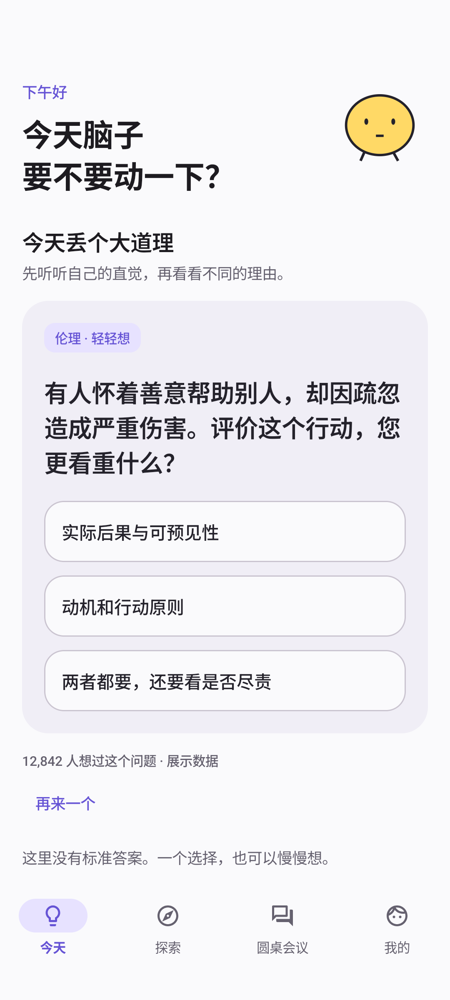
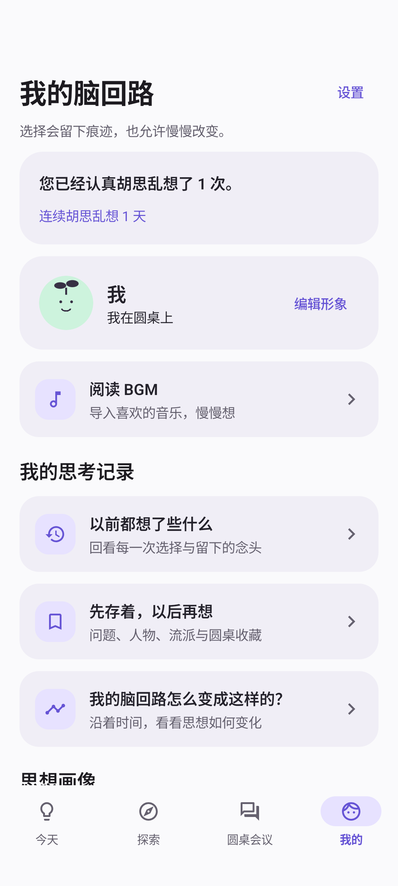
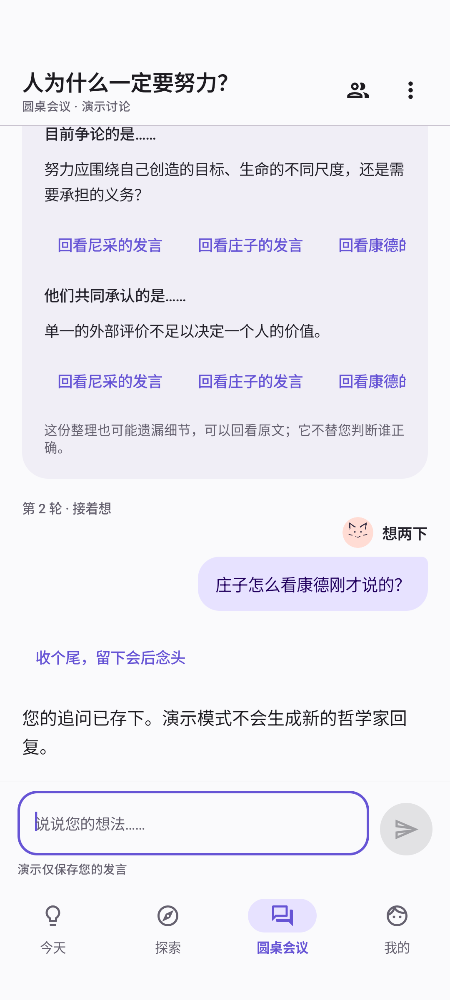
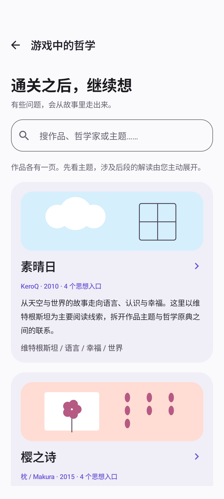
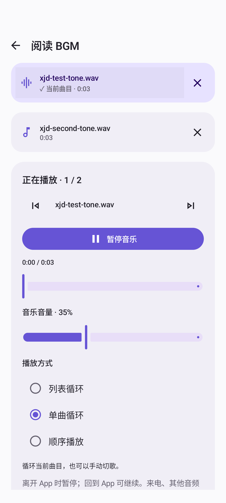
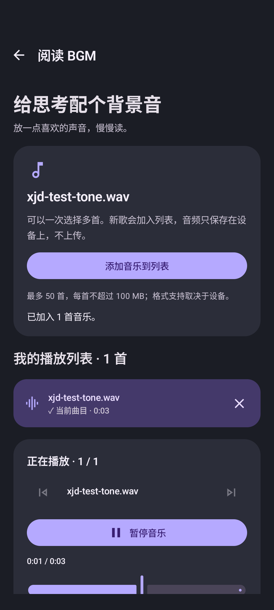
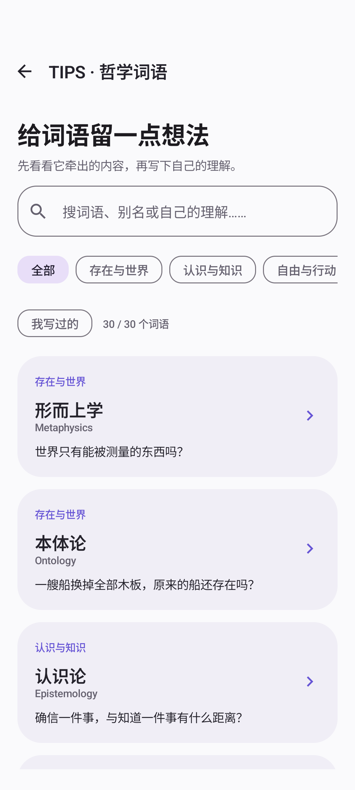
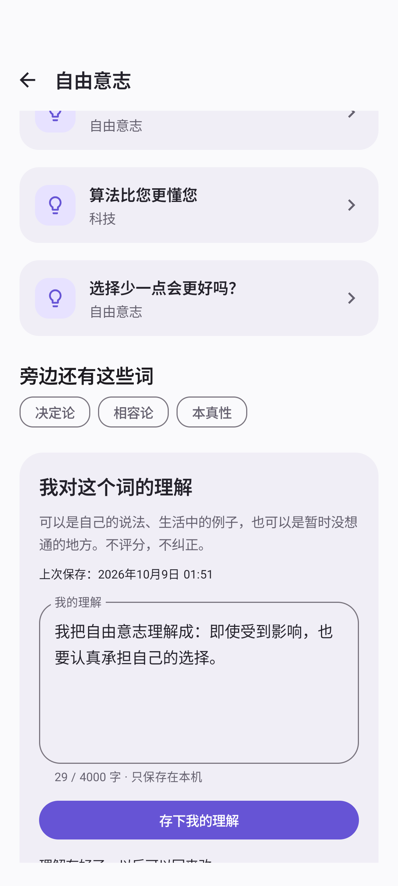

# 小寄丢大道理

**Little Thoughts** · 没事想两下，万一想明白了呢。

一个用哲学思想实验、人生选择和圆桌讨论，帮助您发现「原来我是这么想的」的 Android App。

先做选择，再看分歧与哲学解释，留下念头，过段时间回来看看。这里没有标准答案；思想画像也不是人格测试。

[下载 Android 安装包](https://github.com/lc-052/jidiu_Philosophy/releases/latest) · [版本记录](https://github.com/lc-052/jidiu_Philosophy/releases) · [问题反馈](https://github.com/lc-052/jidiu_Philosophy/issues)

## 看看它长什么样

| 今天的怪问题 | 我的脑回路 |
| --- | --- |
|  |  |

| 圆桌会议 | 游戏中的哲学 |
| --- | --- |
|  |  |

| 本地音乐列表 | 深色模式 |
| --- | --- |
|  |  |

| TIPS 词语卡片 | 我的词语理解 |
| --- | --- |
|  |  |

截图来自 Android 模拟器。圆桌中的演示内容和社区人数均明确标为展示数据。

## 可以做些什么

- **先选，再想**：51 道思想问题，支持 2–5 个选项。今日问题同一天保持一致，也能「再来一个」。选择后才出现哲学背景、不同观点和相关出处。
- **留下当时的自己**：保存回答与 Reflection；再次思考同一问题时，对照过去的选择和留言。支持历史、收藏、连续思考记录和思想快照。
- **看看脑回路**：13 个维度的思想 Bubble，根据选择权重、每题可能得分范围和回答数量生成倾向观察。样本少时明确提示画像模糊，支持回看变化。
- **随便逛逛**：本地搜索问题、22 位哲学家和 15 个流派／思想维度。包含独立语境的儒家与道家、著作、常见误解，以及时间线与思想分歧。
- **TIPS · 哲学词语**：30 个词语卡片，收录形而上学、决定论、自由意志等。详情提供开放问题、书目、人物和关联内容，不写标准释义；最后可保存自己的理解，支持搜索、筛选、修改和草稿恢复。
- **游戏中的哲学**：为《素晴日》《樱之诗》分别提供作品入口和八篇主题笔记。先回答不剧透的问题，再展开解读；剧透默认折叠，作品事实与编辑延伸分开标注。
- **圆桌会议**：最多邀请四位思想家，用抽象头像呈现群聊。用户可设置昵称与头像，定向回应、请求概念解释或生活举例，生成带来源的小结，保存会后念头与讨论。
- **读哲学，也听音乐**：多选导入本地音频，最多 50 首、每首 100 MB。支持曲目列表、上一首／下一首、列表循环／单曲循环／顺序播放、进度和音量。阅读页面底栏可直接控制。
- **按自己的节奏来**：浅色、深色、跟随系统；可关闭的每日提醒；本地数据清理均二次确认。没有金币、等级、排行榜或强制签到。

## 安装

要求 **Android 8.0 / API 26 或更高**。从 [Releases](https://github.com/lc-052/jidiu_Philosophy/releases) 下载 `LittleThoughts-1.0.8-release.apk`，按系统提示允许安装。校验文件随安装包提供。

1.0.8 沿用 1.0.7 的正式签名，可直接覆盖升级正式版；已在模拟器验证旧回答与引导状态保留。

这是使用独立正式签名的 Release 包。此前本地交付的 Debug 包使用不同签名，Android 无法直接覆盖安装；卸载旧包会删除其本地回答、讨论、音乐副本和 Key。当前没有数据导出／迁移功能，如需保留旧数据，请先继续使用旧包。之后使用同一正式签名的版本可以正常升级。

项目不包含预置模型 Key。未配置模型时，其他功能正常可用，圆桌展示明确标注的固定演示讨论。

## 圆桌接入 AI

### 手机直接填写 Key

1. 打开 **我的 → 设置 → 配置模型与 API Key**。
2. 选择「千问」或「兼容接口」，填写供应商接口地址、模型名称和自己的 API Key。
3. 保存后回到圆桌，选择人物、输入话题并开始新会议。

千问提供地域选项，Key、地址和模型权限须匹配。兼容接口需要支持非流式 Chat Completions 和结构化 JSON 输出；不能保证所有供应商与模型都兼容。保存配置不调用模型，「测试连接」和实际讨论会使用自己的账户额度。

Key 使用 Android Keystore 加密保存在设备上，不硬编码、不回填、不写日志，绑定当前接口地址。真实模型请求发送本次讨论的主题、参与者和上下文；不发送您的其他回答、Reflection、画像或本地音乐。

详见 [手机模型配置](docs/AI_CLIENT.md)。模型输出是依据相关思想进行的现代推演，不是哲学家原话；真实付费模型尚未使用用户凭据实测。

### 可选自有 Backend

仓库附带 Python 标准库网关。选择「自有服务」并填写自己的 HTTPS 服务地址，供应商 Key 留在服务端。无需 Backend 也能使用手机直连。

```powershell
# 模型名称和地址按自己的供应商配置；不要提交真实 Key。
$env:AI_UPSTREAM_BASE_URL = 'https://your-provider.example/v1'
$env:AI_MODEL = 'YOUR_MODEL_ID'
$env:AI_API_KEY = 'YOUR_API_KEY'
python backend/server.py
```

默认只监听本机；公开部署需要自行配置 HTTPS、认证和配额。可通过 Gradle 属性 `AI_API_BASE_URL` 预置自己的 HTTPS 地址，须以 `/` 结尾。详见 [服务端运行说明](backend/README.md)、[接口协议](docs/BACKEND.md) 和 [圆桌扩展协议](docs/MEETING_EXPERIENCE.md)。

### 演示模式

内置三场结构化固定讨论。界面显示演示身份，输入和选择人物不会改变预设哲学家发言；追问可保存，但不生成新的 AI 回复。演示小结只依据预设消息。配置模型后，需要「再开一桌」开始真实讨论。

## 开发与构建

- JDK **17**、Android SDK Platform **35**。
- Android Studio 需支持 AGP **8.6.0**（Ladybug 或更高的兼容版本）；以项目 Gradle 配置为准。
- Gradle Wrapper **8.7**、Kotlin **2.0.21**；无需另装全局 Gradle。
- 包名：`com.xiaojidiu.philosophy`；当前版本 **1.0.8 / versionCode 9**。

在 Android Studio 中打开仓库根目录，配置 SDK 后同步并运行 `app`。首次构建需要访问 Google Maven 和 Maven Central。

```powershell
# Windows
.\gradlew.bat :app:assembleDebug
.\gradlew.bat :app:build
```

```bash
# macOS / Linux
./gradlew :app:assembleDebug
./gradlew :app:build
```

Debug APK 位于 `app/build/outputs/apk/debug/app-debug.apk`。本机 SDK 路径写入 `local.properties`；不要提交本机路径、代理或密钥。

### Release 签名

复制 `release-signing.properties.example` 为 `release-signing.properties`，填写自己的 keystore 路径、别名与密码，再构建：

```powershell
.\gradlew.bat :app:assembleRelease
```

有签名配置时，输出 `app/build/outputs/apk/release/app-release.apk`；无配置时输出 `app-release-unsigned.apk`，未签名 APK 不能直接安装。也可使用环境变量 `RELEASE_STORE_FILE`、`RELEASE_STORE_PASSWORD`、`RELEASE_KEY_ALIAS`、`RELEASE_KEY_PASSWORD`，优先于本地配置。

官方 Release 的签名密钥只保存在维护者本机，不上传仓库或 Release。自己的签名与官方签名不同，不能覆盖安装官方包。请妥善备份自己的 keystore 和密码，后续升级必须使用同一签名。

## 技术与架构

Kotlin · Android Native · Jetpack Compose · Material 3 · Navigation Compose · ViewModel · Coroutines / StateFlow · Room · DataStore · Retrofit · OkHttp · Kotlin Serialization · WorkManager。

UI 通过 ViewModel 观察 StateFlow；Repository 协调数据库、设置、Seed、网络和播放器。Composable 不访问 DAO。画像算法和轮次规划独立封装，不增加无意义的空层。

```text
app/
  src/main/
    assets/seed/                # 问题、哲学家、流派、游戏笔记
    java/com/xiaojidiu/philosophy/
      data/local/              # Room、DAO、Entity、Seed、DataStore、KeyStore
      data/remote/             # Retrofit API、结构化 DTO
      data/repository/         # 内容、回答、AI、音乐等 Repository
      domain/model/            # 领域模型
      domain/repository/       # 需要的 Repository 契约
      domain/usecase/          # 画像、连续思考、圆桌／音乐规划
      ui/                      # 各页面、ViewModel、公共组件、主题
      navigation/              # Navigation Compose
      util/                    # 验证、提醒、音频复制等工具
  src/test/                    # JVM Unit Tests
  src/androidTest/             # Room、网络与 Compose 产品流程测试
  schemas/                     # Room schema 与迁移验证
backend/                       # 可选模型网关与 Python 测试
docs/                          # 功能说明、验证记录、实际截图
gradle/wrapper/                # 可重现构建入口
```

### 本地数据与内容

Room schema **3** 保存问题与选项、维度权重、回答、Reflection、哲学家、流派、关联、收藏、思想快照、会话、消息、讨论小结、会后念头及 TIPS 个人理解；包含外键、索引及 1→2→3 迁移。每道问题最新回答用于画像，历次回答保留供回看。

首次启动在 IO 线程把 `assets/seed/` 内容导入 Room，DataStore 记录 Seed Version。内容升级保留历史记录，问题与选项 ID 应保持含义稳定。游戏笔记从 assets 读取，本次直觉选择只恢复页面状态，不写入永久画像。

TIPS 词语目录独立放在 `assets/seed/tips.json`，个人理解通过 Room 保存，不参与画像或模型请求。

DataStore 保存引导、主题、提醒、用户形象、接口配置与音乐列表。音乐复制到 App 私有目录，原文件不变，不扫描整个媒体库，不上传音频。切歌保留曲目；移除副本前确认。前台导航、旋转使用同一个播放器；离开 App 暂停，重新启动不会自动播放。

## 测试

```powershell
.\gradlew.bat :app:testDebugUnitTest :app:testReleaseUnitTest
# 先连接 Android 设备或启动模拟器
.\gradlew.bat :app:connectedDebugAndroidTest
python -m unittest discover -s backend -v
```

当前验证：Debug / Release 各 **54 项 JVM 测试**、**32 项 Android 测试**通过；Android 测试环境为 Pixel 8 / Android 16 / API 36 模拟器。覆盖重复回答、标准化画像、Reflection、收藏、Seed、数据库迁移、真实 HTTP 模拟模型、用户配置、圆桌小结、作品导航、320dp / 180% 字体布局，以及音乐导入、播放、循环、切歌、旧记录升级和 TIPS 草稿、笔记、关联导航及数据迁移。

音频测试模拟系统选择器返回结果，随后真实复制、解析、解码和播放。测试提供器不进入生产 APK。服务端另有 14 项 Python 测试通过。更完整的结果与边界见 [验证记录](docs/VALIDATION.md)。

## 已知限制

- 未在 API 26 真机、厂商系统或实体耳机／来电场景完整验证；尚未人工用 TalkBack 走完所有页面。
- BGM 仅用于 App 前台阅读，暂无后台播放、锁屏控制、随机播放、拖动排序或淡入淡出。
- 没有云同步、数据导出或 Debug → 正式签名包的数据迁移。
- 提醒使用 WorkManager，时间为近似值，受系统省电影响。
- 游戏哲学首批两部作品、八篇笔记；内容和画像权重是编辑性观察，需要持续审校。
- AI 可能误解思想和讨论，小结来源关联不等于观点一定准确；用户应结合原始消息阅读。自有 Backend 须支持当前扩展协议。
- 本仓库没有预置公共模型服务、账户、计费或已部署的公网 Backend。

## 后续方向

完善内容审校与出处；增加更多游戏作品；提供本地数据导出／迁移；继续优化长讨论阅读与音乐列表；扩展真机和无障碍验证。

Release 签名与维护者备份位置见 [签名说明](docs/RELEASE_SIGNING.md)。

## 进一步了解

[TIPS 词语与笔记](docs/TIPS.md) · [游戏哲学内容与出处](docs/GAME_PHILOSOPHY.md) · [圆桌与小结协议](docs/MEETING_EXPERIENCE.md) · [阅读排版](docs/READING_LAYOUT.md) · [BGM 与配色](docs/BGM_AND_PALETTE.md) · [手机 AI 配置](docs/AI_CLIENT.md)

